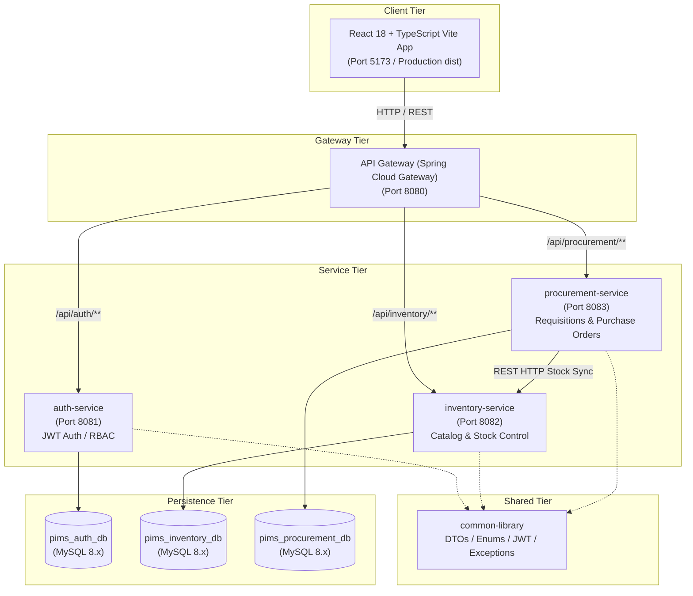

# Architecture Specification

## 1. System Overview

The **Procurement & Inventory Management System (PIMS)** is an enterprise-grade, distributed microservices platform engineered with Spring Boot 3.3.4, Java 17/21, Spring Cloud Gateway, MySQL 8.x, Flyway, and React 18 with TypeScript and Vite.

---

## 2. Microservice Module Breakdown

### 2.1 `common-library`
- **Purpose**: Shared foundation module imported as a standard Maven dependency by backend microservices.
- **Components**:
  - `ApiResponse<T>`, `ErrorResponse`: Unified REST response wrappers.
  - Enums: `RoleName`, `RequisitionStatus`, `PurchaseOrderStatus`, `StockMovementType`, `SupplierStatus`.
  - Security Infrastructure: `JwtTokenProvider`, `JwtAuthenticationFilter`, `SecurityUtils`.
  - Base Exceptions: `ResourceNotFoundException`, `BadRequestException`, `UnauthorizedException`, `ForbiddenException`, `DuplicateResourceException`, `InvalidStateTransitionException`, `InsufficientStockException`.
  - Controller Advice: `BaseGlobalExceptionHandler`.

### 2.2 `api-gateway` (Port 8080)
- **Technology**: Spring Cloud Gateway 4.1.5 (Netty reactive engine).
- **Responsibilities**:
  - Central reverse proxy and API dispatcher for frontend single-page application.
  - Dynamic routing rules:
    - `/api/auth/**` → `http://localhost:8081`
    - `/api/inventory/**` → `http://localhost:8082`
    - `/api/procurement/**` → `http://localhost:8083`
  - Global Cross-Origin Resource Sharing (CORS) filter supporting all REST methods (`GET`, `POST`, `PUT`, `DELETE`, `OPTIONS`).

### 2.3 `auth-service` (Port 8081)
- **Database**: `pims_auth_db`
- **Responsibilities**:
  - User registration and credential authentication.
  - Secure BCrypt password hashing (strength 12).
  - High-entropy HMAC-SHA256 JWT access token generation and validation.
  - Role-based authorization and user role assignments.
  - Open endpoints: `/api/auth/register`, `/api/auth/login`, `/api/auth/refresh`.
  - Protected endpoints: `/api/auth/me`, `/api/auth/users`, `/api/auth/users/{userId}/roles`.

### 2.4 `inventory-service` (Port 8082)
- **Database**: `pims_inventory_db`
- **Responsibilities**:
  - Product catalog management (SKU, description, pricing, reorder thresholds).
  - Category and Warehouse master records.
  - Multi-warehouse stock tracking with JPA optimistic locking (`@Version`).
  - Stock movement transaction history (`INBOUND_RECEIPT`, `OUTBOUND_DISPATCH`, `ADJUSTMENT_ADD`, `ADJUSTMENT_SUBTRACT`).
  - Low-stock proactive alerts based on defined SKU thresholds.
  - Inter-service Goods Receipt fulfillment endpoint (`/api/inventory/stock/goods-receipt`).

### 2.5 `procurement-service` (Port 8083)
- **Database**: `pims_procurement_db`
- **Responsibilities**:
  - Accredited supplier onboarding and tax compliance records.
  - Multi-line Purchase Requisitions lifecycle management.
  - Segregation-of-duties approval queue: prevents employees from self-approving their own requisitions.
  - Purchase Order lifecycle (`DRAFT` → `APPROVED` → `SENT` → `PARTIALLY_RECEIVED` → `RECEIVED` / `CANCELLED`).
  - Approved Requisition to PO automated conversion.
  - Goods Receipt recording with over-delivery protection and synchronous inventory stock synchronization.
  - Procurement analytics and spend aggregations.

### 2.6 `frontend` (Port 5173 / Production Build)
- **Technology**: React 18, TypeScript 5, Vite, Axios, modern CSS.
- **Features**:
  - Role-aware enterprise navigation sidebar.
  - Live KPI executive dashboard with low-stock alerts.
  - Product catalog with search and filters.
  - Inventory management with stock adjustment modal and movement audit trail.
  - Supplier directory with tax ID tracking and accreditation status.
  - Requisition creation with dynamic line item calculations.
  - Dedicated Approvals Queue enforcing separation of duties.
  - Purchase order dispatch and conversion workflows.
  - Step-by-step goods receipt processor with remaining quantity validation.
  - Spend analytics charts and user role management console.

---

## 3. Security & Inter-Service Architecture

### 3.1 Authentication & Authorization Flow
1. User logs in at `POST /api/auth/login`.
2. `auth-service` validates credentials against MySQL using BCrypt.
3. If valid, an HMAC-SHA256 signed JWT is generated containing `sub` (username), `userId`, and `roles`.
4. The client receives the JWT and stores it securely in `localStorage`.
5. For all subsequent calls, the client attaches `Authorization: Bearer <token>`.
6. Each microservice decodes the JWT statelessly using `JwtTokenProvider` and populates the `SecurityContextHolder`.

### 3.2 Inter-Service Integration
When an inbound shipment arrives, the user completes a Goods Receipt in `procurement-service`.
`procurement-service` executes a transactional update:
1. Validates that `quantityReceived <= remainingQuantityOrdered`.
2. Saves `GoodsReceipt` and `GoodsReceiptItem` records.
3. Invokes `InventoryClient` (`RestTemplate`) calling `POST http://localhost:8082/api/inventory/stock/goods-receipt`.
4. `inventory-service` locates or creates the stock item for the product and warehouse, increments quantity with optimistic locking, and writes a `StockMovement` audit record.
5. If received quantity fulfills all ordered items, `procurement-service` automatically advances PO status to `RECEIVED` (or `PARTIALLY_RECEIVED` if partial).
