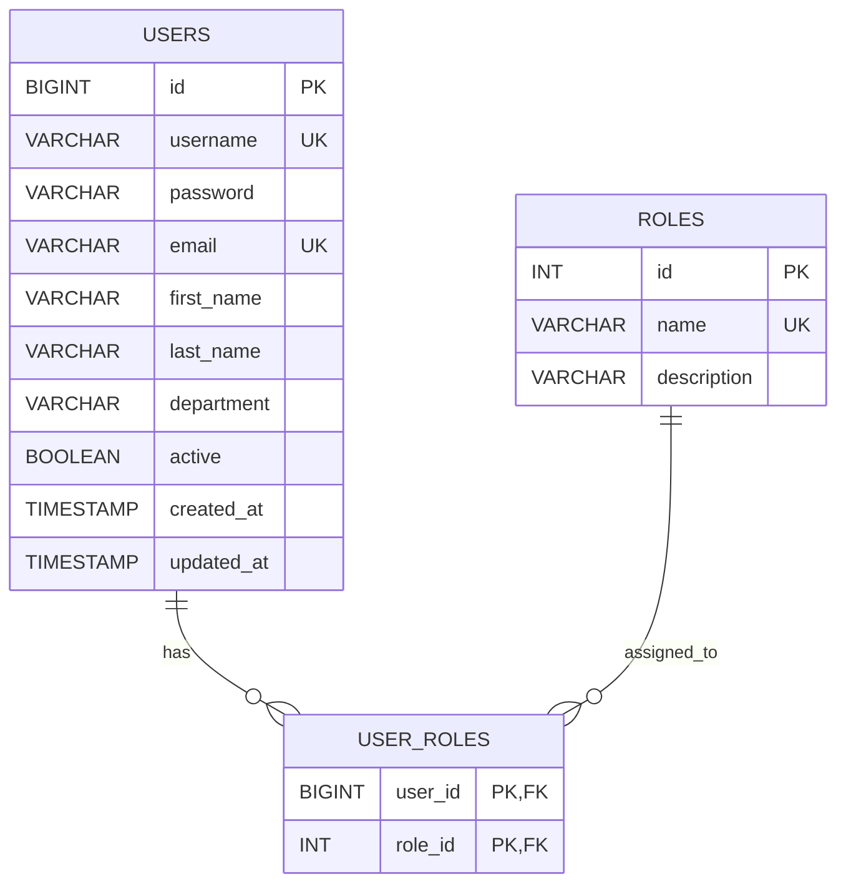
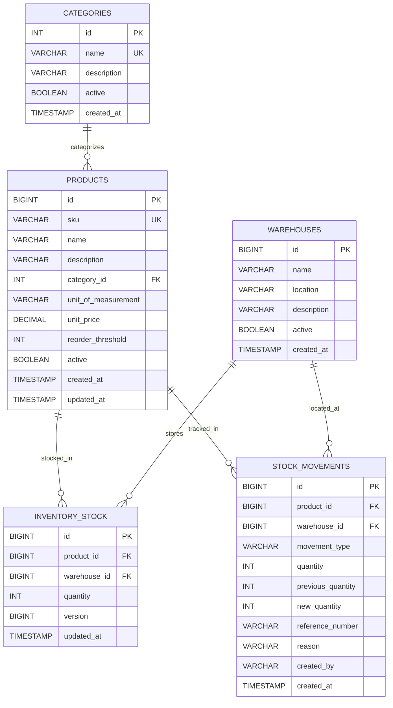
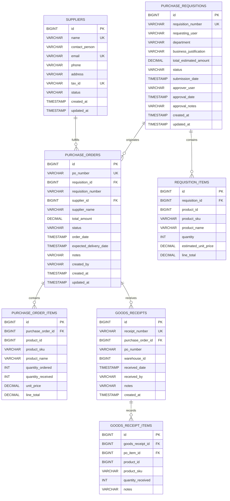

# Database Design & Architecture Specification

## 1. Overview & Principles

The Procurement & Inventory Management System (PIMS) adopts a **Database-per-Service** architectural pattern to ensure loose coupling, independent scalability, and domain isolation.
Each microservice governs its own MySQL 8.x schema via Flyway migrations:

1. `pims_auth_db`: Identity, credentials, and role assignments.
2. `pims_inventory_db`: Warehouses, product catalog, stock records, and movement audit log.
3. `pims_procurement_db`: Suppliers, purchase requisitions, purchase orders, approval records, and goods receipts.

## 2. Global Conventions
- Primary keys are `BIGINT AUTO_INCREMENT` (or `INT AUTO_INCREMENT` for reference dictionaries).
- Audit timestamps (`created_at`, `updated_at`) are automatically set with `TIMESTAMP DEFAULT CURRENT_TIMESTAMP`.
- Financial amounts and monetary values use `DECIMAL(14, 2)` or `DECIMAL(12, 2)` to eliminate floating-point rounding errors.
- Quantities use `INT NOT NULL` with application- and schema-level non-negative constraints.
- Foreign keys maintain referential integrity with appropriate `ON DELETE RESTRICT` or `ON DELETE CASCADE` cascading where appropriate.
- Database schema changes are tracked strictly via Flyway migration scripts in each service (`src/main/resources/db/migration/V1__*.sql`).

---

## 3. Schemas & Entity-Relationship Details

### 3.1 Auth Database (`pims_auth_db`)

#### Roles Seeded:
- `ADMIN`: Full platform authority and user administration.
- `PROCUREMENT_MANAGER`: Requisition approvals, PO oversight, vendor management.
- `PROCUREMENT_OFFICER`: PO creation, supplier management, vendor dispatch.
- `INVENTORY_MANAGER`: Product catalog, warehouse management, stock adjustments.
- `APPROVER`: Requisition approval queue review and authorization.
- `EMPLOYEE`: Requisition creation and personal tracking.

---

### 3.2 Inventory Database (`pims_inventory_db`)

#### Optimistic Locking & Concurrency Control
- `inventory_stock` features a `version BIGINT DEFAULT 0` column annotated with `@Version` in JPA.
- When concurrent transactions (e.g. concurrent goods receipts or manual stock adjustments) update the stock of the same product at the same warehouse, JPA checks the version and raises an `OptimisticLockingFailureException`, preventing lost updates.

---

### 3.3 Procurement Database (`pims_procurement_db`)

---

## 4. Key Integrity & Business Rules
1. **Segregation of Duties**: In `purchase_requisitions`, a user cannot approve their own requisition (`requestingUser != approverUser`).
2. **Deterministic State Progression**:
   - Requisition: `DRAFT` → `SUBMITTED` → `APPROVED` / `REJECTED` → `CONVERTED_TO_ORDER` / `CANCELLED`.
   - Purchase Order: `DRAFT` → `APPROVED` → `SENT` → `PARTIALLY_RECEIVED` → `RECEIVED` / `CANCELLED`.
3. **Goods Receipt Over-Receipt Prevention**: `quantityReceived` for any line item cannot exceed `(quantityOrdered - quantityReceived)`.
4. **Inter-Service Stock Ingestion**: Recording a Goods Receipt transactionally validates receipt quantities in `procurement-service` and calls `POST /api/inventory/stock/goods-receipt` in `inventory-service` to augment warehouse stock and write audit movement entries.
